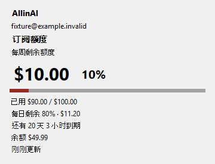
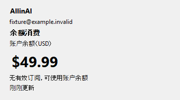

# AllinAI Quota Tray for Windows

轻量原生 Windows 托盘工具，用于查看 AllinAI 订阅额度、账户余额和到期状态。

**当前版本：0.2.0 · Windows 10/11 · C# / WinForms / .NET 8**

macOS 版继续在独立仓库维护：[allinai-quota-menu](https://github.com/qx0657/allinai-quota-menu)。两端以相同业务规则为目标，系统集成保持原生。功能对应关系见[同步维护说明](docs/NATIVE_PARITY.md)。

下载：[Windows v0.2.0](https://github.com/qx0657/allinai-quota-tray-windows/releases/tag/v0.2.0)（x64 自包含版，无需另装 .NET）。版本变化见[更新记录](CHANGELOG.md)。

## 功能

- 只常驻系统托盘，左右键都能打开菜单；不创建常驻主窗口。
- 原生只读账户概览突出剩余金额、比例、周期、到期时间、余额与成功更新时间。
- 每日、每周、每月同时有限额时，主指标选剩余比例最低的已知周期；可从订阅详情切换主订阅。
- 没有有效订阅时，有余额则进入余额消费模式；过期订阅保留在详情中。
- 圆环与进度条都表示剩余比例。余额使用货币图标，未知、无额度和未登录使用不同符号；图标保留亮暗任务栏均可见的黑白轮廓。
- 默认五分钟刷新，可选 1 / 5 / 10 / 30 分钟；支持手动刷新、睡眠暂停、唤醒和网络恢复。
- 订阅与余额分别保留最近成功数据；缺失用量不会补成零，刷新失败不清空已知余额。
- 认证错误才恢复登录；合并并发令牌续期，遵守限流冷却并对持续失败退避。
- 可选到期、低额度与低余额提醒，默认关闭；启动时已有告警条件静默记录，相同周期内去重。
- 密码保存在 Windows 凭据管理器，验证登录成功后才保存；支持重新登录和退出登录。
- 当前用户开机自启动、单实例运行、版本显示与 GitHub 检查更新。

## 原生界面预览

以下由 Windows CI 使用生产 `SummaryPanel` 和图标代码、**模拟数据**生成。它们是菜单内的只读概览，不包含完整操作菜单，也不代表通知和任务栏交互已完成人工验收。

| 订阅模式 | 余额模式 |
| --- | --- |
|  |  |

亮暗背景上的托盘图标（满额度、低额度、余额、耗尽、未知、未登录）：


## 下载与安装

从上述 Release 下载 `AllinAIQuotaTray-v0.2.0-win-x64.zip`，完整解压到固定位置，双击 `AllinAIQuotaTray.exe`。也可下载单独的同名 exe；正式版已包含 .NET 运行时。校验文件为 `SHA256SUMS.txt`，ZIP 内附安装说明。

应用常驻系统托盘，图标可能在 `^` 溢出区。更新时先从旧进程菜单选择“退出”，再替换文件并启动；原有本地账号数据会保留。移动程序后重新开启“开机自启动”以更新路径。完整说明见 [INSTALL.txt](docs/INSTALL.txt)。

## 从源码构建和运行

开发需要 .NET 8 SDK。运行默认发布产物需要 **.NET 8 Windows Desktop Runtime**；可选择自包含发布。

```powershell
dotnet build -c Release
dotnet run -c Release
```

发布框架依赖的单文件程序：

```powershell
.\build.ps1
```

发布自包含程序，用户无需另装 .NET Runtime：

```powershell
.\build.ps1 -SelfContained
```

输出为 `publish\win-x64\AllinAIQuotaTray.exe`。脚本在临时目录发布并核对版本后替换目标；编译失败保留旧产物。覆盖前需要先从托盘菜单退出旧进程。

当前源码仍以 .NET 8 为目标，不引入额外桌面框架。应用没有数字签名，分发时 Windows SmartScreen 可能提示未知发布者。

## 使用与状态

点击图标选择“登录…”，输入邮箱和密码。错误在登录表单内显示；正确登录后自动获取额度和余额。

| 账户状态 | 显示 |
| --- | --- |
| 有有效订阅 | 展示最受限周期的剩余金额、剩余比例和进度 |
| 无有效订阅，余额大于零 | 显示“余额消费”与金额，不绘制没有分母的额度环 |
| 无有效订阅，余额不大于零 | 显示“暂无可用额度” |
| 信息不完整或尚未获取 | 使用问号、`--` 与待确认说明 |
| 刷新失败 | 保留最近成功数据，标明刷新失败及成功更新时间 |
| 认证失效 | 显示重新登录入口，停止自动重试账号请求 |

订阅额度与余额分别显示，不直接相加。有效订阅耗尽时仍显示耗尽；服务是否自动改扣余额尚未确认，应用不自行假设。主订阅选择只在本次运行中保留。

Windows 托盘不支持 macOS 那样在图标旁直接追加数值，金额和百分比通过 tooltip 与概览表达。tooltip 保守截断至 63 个 UTF-16 单位；完整说明在菜单中查看。图标是否收进 `^` 溢出区由 Windows 与用户设置决定。

## 菜单

- **立即刷新**：请求中、认证失效、睡眠或限流期间不可用；手动刷新也遵守服务冷却时间。
- **订阅详情**：包含有效、过期订阅、周期用量、开始和到期时间；可选择主订阅，长说明可展开。
- **刷新间隔**：1 / 5 / 10 / 30 分钟，默认五分钟。调度在到期后由每 15 秒一次的本地计时器检查，计时器不代表每 15 秒请求服务。
- **开机自启动**：仅修改当前用户的注册表 Run 项，不需管理员权限。
- **账号与工具**：重新登录、确认退出登录、提醒设置与打开配置目录。
- **关于 AllinAI Quota**：检查更新、可选每日自动检查、下载入口、更新记录与源码地址。
- **版本：v0.2.0** 和 **退出**：版本来自程序集元数据；退出应用保留会话，退出登录清除令牌与对应密码。

### 提醒

“开启额度与到期提醒”默认关闭。开启后使用 Windows 原生托盘通知：到期前 3 天 / 1 天、已知主周期剩余不高于 10% 时提醒。低余额阈值可选关闭 / $1 / $5 / $10，默认关闭；单独选择阈值不会开启提醒总开关。

提醒只在程序运行且相关数据成功刷新后评估。初次观察已有条件时静默记录，不补发历史提醒；低余额在充值超过阈值后重新触发。多个提醒排队投递，避免同时覆盖。系统通知设置、专注模式和应用退出会影响实际显示；应用无法确认操作系统是否向用户展示了通知。

### 检查更新

更新源为此 Windows 仓库的 `GET /repos/qx0657/allinai-quota-tray-windows/releases/latest`。稳定版本使用 `v主版本.次版本.修订号` 标签。按数值比较，忽略草稿和预发布，不建议降级。

自动检查默认关闭；开启后最多每 24 小时请求一次，跨重启保存调度，失败也计入频率。后台检查不弹窗；发现新版时通过“关于”和 tooltip 提示。GitHub 限流冷却跨重启保留，手动检查也遵守它。

更新请求不使用 AllinAI 邮箱、密码、令牌或 Cookie。通过浏览器打开 Release 下载 Windows 版本，退出旧进程后替换；不自动安装。仅推送源码或创建 tag 不等于发布了客户端可发现的 Release。

## 本地数据与兼容

| 内容 | 位置 |
| --- | --- |
| 配置、会话和偏好 | `%APPDATA%\AllinAIQuotaTray\` |
| `config.json` | 仅邮箱 `email`、刷新间隔 `refreshIntervalSeconds` |
| `tokens.json` | access / refresh token、Unix 到期时间与可选账号标识 |
| `preferences.json` | 提醒、显式退出状态、检查更新时间与限流、提醒去重记录 |
| 密码 | Windows 凭据管理器，target：`local.allinai.quota.tray.windows:<email>` |
| 自启动 | `HKCU\Software\Microsoft\Windows\CurrentVersion\Run\AllinAIQuotaTray` |

文件使用临时文件和原子替换写入，存放在当前用户的数据目录。保留 0.1.0 的目录、凭据 target 和 UTF-16 密码格式，兼容原来没有 `account` 字段的令牌缓存。旧明文密码配置会迁入凭据管理器后移除密码属性。

额度快照只保留在进程内存中。不要提交本地配置、令牌、凭据或包含它们的反馈材料。移动 exe 后，重新开启自启动以更新路径。

## 开发与验证

```text
Program.cs                 # 托盘、原生菜单、生命周期与系统事件
Views.cs                   # 只读概览、进度条、异步登录表单
WindowsIntegration.cs      # 图标、Credential Manager、Run 项与版本
Core/Models.cs             # 额度规则、类型、错误与展示内容
Core/Client.cs             # 本地存储、账户请求、会话与时区
Core/QuotaStore.cs         # 刷新状态、取消、退避、提醒
Core/Updates.cs            # 独立 GitHub 更新检查
Tests/CoreTests.csproj     # 无第三方测试依赖的跨平台业务回归
Tests/NativeSmoke.csproj   # Windows 原生渲染与凭据读写检查
.github/workflows/         # Windows 构建、发布校验、启动与单实例检查
```

业务测试可在有 .NET 8 SDK 的 Windows / macOS / Linux 运行，不连接真实服务，不读取真实凭据，使用临时目录和运行时生成的测试凭据。

```powershell
dotnet run --project Tests/CoreTests.csproj -c Release
```

在 Windows 验证生产 WinForms 视图、托盘图标和 Credential Manager（仅写入随机测试账号并在结束后删除）：

```powershell
dotnet run --project Tests/NativeSmoke.csproj -c Release -- publish/previews
```

在 macOS / Linux 只能交叉编译 Windows 程序，不能据此声称原生 UI、通知或自启动已通过实机验证：

```sh
dotnet build allinai-quota-tray-windows.csproj -c Release -p:EnableWindowsTargeting=true
```

当前业务回归为 41 项。CI 验证业务测试、原生编译、模拟数据视图、随机凭据往返、发布文件版本、启动和单实例。真实菜单操作、亮暗任务栏、高 DPI、通知投递与睡眠恢复仍应人工检查。历史 0.1.0 截图保存在 `docs/images/`，不代表当前界面。

## 服务地址

保留实际服务地址：`https://allincode.top/api/v1` 与 `https://allincode.top/subscriptions`。

使用 `POST /auth/login`、`POST /auth/refresh`、`GET /subscriptions?timezone=<IANA-timezone>`、`GET /user/profile`。响应格式为 `{ code, message, data }`。时区使用 .NET 的系统时区转换能力；不再维护有限的 Windows 到 IANA 映射表。

## 版本与发布

发布时同步更新项目中的 `Version`、`AssemblyVersion`、`FileVersion`、`InformationalVersion` 及相关文档。先通过验证，再从匹配的版本标签手动运行自包含发布构建，核对 ZIP、exe 和 SHA-256 后发布 GitHub Release。常规推送的 CI 产物是框架依赖版；正式 Release 是自包含版。两个原生仓库分别发布，各自检查各自的 Release。具体命令见[发布指南](docs/RELEASING.md)。

## 维护文档

- [更新记录](CHANGELOG.md)
- [发布指南](docs/RELEASING.md)
- [原生版本同步维护](docs/NATIVE_PARITY.md)
- [AGENTS.md](AGENTS.md) / [CLAUDE.md](CLAUDE.md)：标记区镜像的代理协作规则。

初版由 OpenAI Codex 协助实现。项目继续保持原生、轻量、单账号工具的定位。
