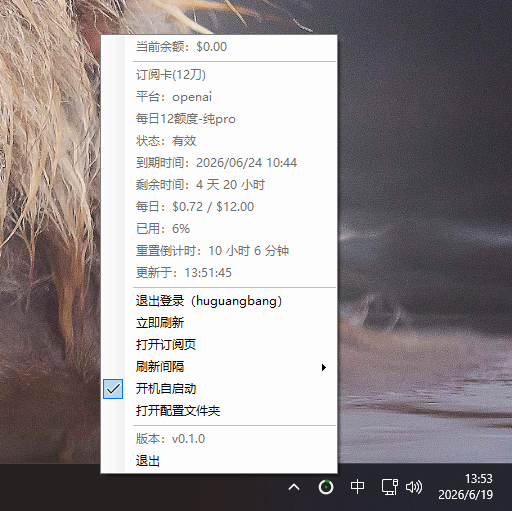

# AllinAI Quota Tray for Windows

Lightweight Windows tray app for viewing AllinAI subscription quota.

Current version: `0.1.0`

Platform: **Windows**.

This is the Windows counterpart of the macOS `allinai-quota-menu` project. The macOS version is available at [qx0657/allinai-quota-menu](https://github.com/qx0657/allinai-quota-menu). This project keeps the same basic behavior while using native WinForms APIs instead of a heavy desktop runtime.

## Features

- Tray progress icon for quota usage.
- High-contrast tray icon designed for dark and light Windows taskbars.
- Left-click or right-click the tray icon to open the menu.
- Tooltip with remaining quota percentage and account balance.
- Login dialog with password stored in Windows Credential Manager.
- Access/refresh token cache under `%APPDATA%\AllinAIQuotaTray`.
- Manual refresh, logout, configurable refresh interval, subscription page shortcut.
- Optional current-user startup entry from the tray menu.
- Version metadata in the executable and tray menu for future upgrades.

## Screenshots

Tray tooltip:


Tray menu:



## Requirements

- Windows 10/11.
- .NET 8 SDK for development.
- .NET 8 Windows Desktop Runtime for framework-dependent publish output.
- Network access to `https://allincode.top`.

## Project Layout

```text
.
├── Program.cs                         # App source, tray UI, API client, storage helpers
├── allinai-quota-tray-windows.csproj  # WinForms project and version metadata
├── app.manifest                       # App manifest
├── build.ps1                          # Release publish script
├── README.md                          # User/developer documentation
├── AGENTS.md                          # Notes for future AI/code agents
├── docs/images/                       # README screenshots
├── bin/                               # Build output
├── obj/                               # Build cache
└── publish/win-x64/                   # Single-file publish output
```

## Build And Run

Build:

```powershell
dotnet build -c Release
```

Run from source:

```powershell
dotnet run -c Release
```

Publish a framework-dependent single executable:

```powershell
.\build.ps1
```

The publish output is written to:

```text
publish\win-x64\
```

Main executable:

```text
publish\win-x64\AllinAIQuotaTray.exe
```

If the app is already running, stop `AllinAIQuotaTray.exe` before publishing because Windows locks the running executable.

## Local Data

Config and token cache:

```text
%APPDATA%\AllinAIQuotaTray\
```

Files:

```text
config.json
tokens.json
```

Password credential target prefix:

```text
local.allinai.quota.tray.windows
```

Startup toggle registry value:

```text
HKCU\Software\Microsoft\Windows\CurrentVersion\Run\AllinAIQuotaTray
```

## App Behavior

- On launch, the app creates a `NotifyIcon` and runs as a tray-only WinForms app.
- If credentials exist, it refreshes quota immediately and then on the configured interval.
- Menu entries are rebuilt on open so status, version, startup state, and quota details stay current.
- The tray tooltip is short by design because Windows tray tooltip text has a small length limit.
- Windows controls whether a tray icon is shown directly or hidden under the `^` overflow area. The app cannot reliably force itself to stay visible outside the overflow area.

## Service API

Base API:

```text
https://allincode.top/api/v1
```

Used endpoints:

```text
POST /auth/login
POST /auth/refresh
GET  /subscriptions?timezone=<local-timezone>
GET  /user/profile
```

Subscription page:

```text
https://allincode.top/subscriptions
```

Do not rename the API host unless the backend endpoint has actually changed.

## Versioning

Version metadata lives in:

```text
allinai-quota-tray-windows.csproj
```

Update these together for a release:

```xml
<Version>0.1.0</Version>
<AssemblyVersion>0.1.0.0</AssemblyVersion>
<FileVersion>0.1.0.0</FileVersion>
<InformationalVersion>0.1.0</InformationalVersion>
```

After publishing, verify:

```powershell
(Get-Item .\publish\win-x64\AllinAIQuotaTray.exe).VersionInfo |
  Select-Object ProductName,ProductVersion,FileVersion,CompanyName
```

## Credits

The initial Windows implementation was generated with assistance from OpenAI Codex.

Codex helped translate the behavior of the macOS `allinai-quota-menu` project into a lightweight native Windows tray app, including the WinForms tray application structure, AllinAI API client, Credential Manager integration, startup toggle, dynamic tray icon, tooltip behavior, publish script, and project documentation.

The project remains owned, reviewed, configured, and maintained by the project owner. Future changes should continue to follow the lightweight native Windows direction described in this README and in `AGENTS.md`.

## Notes

- The app-visible name is `AllinAI Quota`.
- This is a local unsigned build. Windows SmartScreen may warn when sharing the executable.
- Startup is per-user and does not require administrator privileges.
- Passwords must not be stored in source, config files, or token cache.
